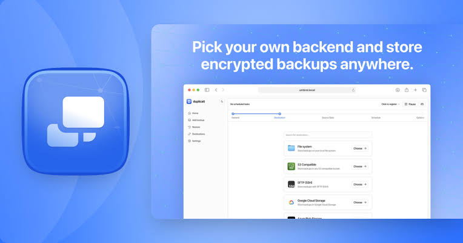
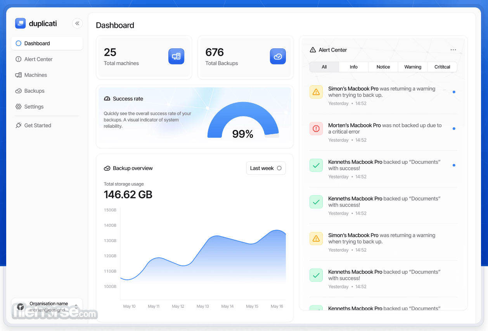

# Duplicati App for Encrypted Cloud Backup Management

Duplicati App helps protect files with encrypted, incremental backups.
Duplicati runs on Windows, macOS, and Linux and offers both a web interface and command-line tools.

Duplicati cloud backup lets you choose a destination while retaining control of the encryption passphrase.
The Duplicati open source backup client supports compression, scheduling, and recovery of earlier file versions.
A Duplicati self-hosted deployment keeps the backup application under your administration.

[](https://duplicati-app.github.io/Duplicati/)

## Features

The client prepares backup data before sending it to the selected destination.
After the initial backup, subsequent runs reuse existing data and transfer new or changed blocks.

- Encrypt backup contents locally before upload.
- Compress data to reduce the storage footprint.
- Schedule recurring jobs through the web interface.
- Select source folders and apply inclusion or exclusion filters.
- Restore selected files from an available backup version.
- Use a CLI when an external scheduler or script is preferable.

The [official project description](https://github.com/duplicati/duplicati) covers the client and its supported platforms.
Storage capacity and provider charges depend on the destination you choose.

For Linux or macOS, this Bash example backs up a documents directory to a mounted backup disk:

```bash
: "${PASSPHRASE:?Set the backup encryption passphrase first}"
duplicati-cli backup "file:///mnt/backup/duplicati-documents" "$HOME/Documents" \
  --encryption-module=aes \
  --compression-module=zip \
  --dbpath="$HOME/.config/duplicati-documents.sqlite"
```

Supply the passphrase through the environment before running the example.
The destination should be separate from the source, and its parent mount must be available.

The example uses Duplicati's CLI; Windows packages provide the corresponding executable.
Its wrapper entry point is [Program.cs](Executables/Duplicati.CommandLine/Program.cs).

These commands assume a working Duplicati installation.
The selected source files in this repository do not constitute a complete build environment.



## Why Use Duplicati?

A backup job combines source selection, a destination, encryption, and a recovery history.
These choices should match the files you need to recover and the time available for restoration.

| Decision | What to consider | Useful confirmation |
| --- | --- | --- |
| Source selection | Documents, photos, and application data that matter | Inspect the selected folders and filters |
| Destination | Capacity, network access, and provider terms | Confirm the destination is reachable |
| Encryption | A passphrase you can retrieve during recovery | Keep an accessible recovery record |
| Schedule | How much recent work you could recreate | Check the last successful run |
| Retention | How far back a useful version might be needed | Review the available backup versions |
| Recovery | Where restored files should be written | Open files from a trial restoration |

Restoration is a separate operation from uploading backup volumes.
A practical check recovers a small selection of files and confirms that their contents are usable.

This Bash example finds backup versions and restores text files into a staging directory:

```bash
: "${PASSPHRASE:?Set the matching backup encryption passphrase first}"
duplicati-cli find "file:///mnt/backup/duplicati-documents"
duplicati-cli restore "file:///mnt/backup/duplicati-documents" "*.txt" \
  --restore-path="$HOME/duplicati-restore-check" \
  --dbpath="$HOME/.config/duplicati-documents.sqlite"
```

The quoted pattern is passed to Duplicati rather than expanded by Bash.
The restore destination separates recovered files from their original locations.

See the [official CLI reference](https://docs.duplicati.com/duplicati-programs/command-line-interface-cli) for command behavior.
The examples above were prepared from documented syntax and were not executed.

## Storages

Duplicati supports local and remote destinations through backend implementations.
Choose a separate destination folder for each backup job.

The following files are integration tests for the named destinations.
They are useful source references, not the backend implementations themselves.

| Destination | Typical role | Included test reference |
| --- | --- | --- |
| Amazon S3 | Store backup volumes in object storage | [S3Tests.cs](LiveTests/Duplicati.Backend.Tests/S3/S3Tests.cs) |
| Google Drive | Use an authorized Drive account | [GoogleDriveTests.cs](LiveTests/Duplicati.Backend.Tests/Google%20Drive/GoogleDriveTests.cs) |
| Microsoft OneDrive | Store volumes through the OneDrive backend | [OneDriveTests.cs](LiveTests/Duplicati.Backend.Tests/OneDrive/OneDriveTests.cs) |
| Backblaze B2 | Use a B2 bucket and application credentials | [B2Tests.cs](LiveTests/Duplicati.Backend.Tests/B2/B2Tests.cs) |
| SFTP over SSH | Use storage on an SSH-accessible server | [SSHTests.cs](LiveTests/Duplicati.Backend.Tests/SSH/SSHTests.cs) |
| WebDAV | Use a compatible remote file service | [WebdavTests.cs](LiveTests/Duplicati.Backend.Tests/Webdav/WebdavTests.cs) |

Cloud-provider authentication and the backup encryption passphrase have different purposes.
Provider credentials authorize storage access; the passphrase protects encrypted backup contents.

Consult the [destination overview](https://docs.duplicati.com/backup-destinations/destination-overview) for current choices and configuration details.
For an existing job, exporting its command line can help preserve the destination-specific options.

A destination change should be evaluated together with its database association and backup history.
Do not assume that changing a URL transfers the existing backup to another provider.



## Support

The [Duplicati manual](https://docs.duplicati.com/) explains backup management, recovery, and platform-specific behavior.
The [community forum](https://forum.duplicati.com/) provides a place to discuss operational questions.

The source selection includes separate entry points for desktop and background operation:

- The tray application starts through [Program.cs](Executables/Duplicati.GUI.TrayIcon/Program.cs).
- The Windows service starts through [Program.cs](Executables/Duplicati.WindowsService/Program.cs).

Service operation also depends on the operating-system identity running the application.
That identity must be able to access the selected source folders and destination.

For verification and recovery research, the collection includes:

- [DuplicatiVerify.py](Tools/Verification/DuplicatiVerify.py), which checks files against uploaded verification manifests.
- [DuplicatiVerify.ps1](Tools/Verification/DuplicatiVerify.ps1), a PowerShell verification utility.
- [restore_from_python.py](Tools/Commandline/RestoreFromPython/restore_from_python.py), an alternative Python restoration utility.

The Python restore utility describes AES and unencrypted ZIP support in its source comments.
Its documented GPG path requires decryption before that utility is used.

Verification of stored volumes and successful file restoration answer different questions.
A recovery plan should account for the encryption passphrase, destination access, and usable restored data.

## Contributing

Useful contributions connect a reproducible observation to the affected component.
The included files cover executable wrappers, integration tests, browser tests, and maintenance tools.

The source selection also contains [ConfigAutoTune.cs](Tools/AutoTune/ConfigAutoTune.cs).
It defines tuning inputs such as concurrency candidates, warmup runs, temporary paths, and test-data limits.

The tuning tool's configuration concerns measurement workloads.
It should not be treated as the export format of a normal backup job.

### Reporting Bugs

Search the [official issue tracker](https://github.com/duplicati/duplicati/issues) before filing a report.
Include enough context to distinguish a backend problem from source access, authentication, or UI behavior.

A useful report records:

- Duplicati version, operating system, and deployment method.
- Destination type and the operation being performed.
- Expected result, actual result, and reproduction steps.
- Relevant error messages with credentials and private file details removed.

Browser-level source references include [backupRestore.spec.ts](playwright-tests/backupRestore.spec.ts).
Its setup prepares source, destination, restoration, and temporary test locations.

[loginPages.spec.ts](playwright-tests/loginPages.spec.ts) covers login-page behavior and captures browser errors.
The existence of these tests does not establish that this source selection has passed them.

### Contributing Code

The included client example demonstrates password-based authentication to a Duplicati server.
Its source is [Program.cs](WebserverCore.Client.UsageExample/Program.cs).

This C# fragment uses that client API with environment-supplied connection settings:

```csharp
using Duplicati.WebserverCore.Client;
using Duplicati.WebserverCore.Dto;
using Duplicati.WebserverCore.Dto.V2;

var endpoint = Environment.GetEnvironmentVariable("DUPLICATI_SERVER_URL")
    ?? throw new InvalidOperationException("Provide the server URL.");
var password = Environment.GetEnvironmentVariable("DUPLICATI_SERVER_PASSWORD")
    ?? throw new InvalidOperationException("Provide the server password.");
using var client = new DuplicatiServerClient(endpoint, ServerCredentialType.Password, password);
await client.AuthenticateAsync();
```

The example requires the matching Duplicati client package or project reference.
The server password authenticates the API session and is separate from a backup encryption passphrase.

Use the [developer documentation](https://docs.duplicati.com/installation-details/developer) for a complete development environment.
Keep changes scoped to the behavior you can explain and verify.

## Licensing

The upstream project identifies its core as MIT-licensed.
It distinguishes separately licensed proprietary components from that core.

Preserve component notices and check the terms of anything you redistribute.
An open-source backup client does not include free storage from every supported provider.

## Related Search Terms

Duplicati App, Duplicati, duplicati cloud backup, duplicati open source backup, duplicati self-hosted, backup, cloud-backup, encryption, compression, deduplication, incremental-backup, restore, self-hosted, cross-platform, csharp
